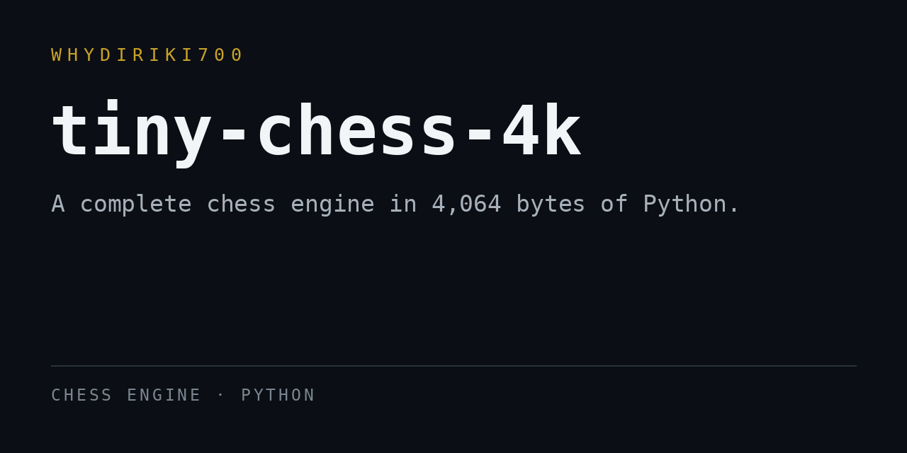

# tiny-chess-4k

[](https://make.fun/bounty/tiny-chess-01?utm_source=github&utm_medium=readme&utm_campaign=tiny-chess-01)
[](https://make.fun/bounty/tiny-chess-01/leaderboard?utm_source=github&utm_medium=readme&utm_campaign=tiny-chess-01)
[](https://make.fun/bounty/tiny-chess-01?utm_source=github&utm_medium=readme&utm_campaign=tiny-chess-01)

A complete chess engine in 4,020 bytes of Python, written for the make.fun tiny-chess-01 bounty: the strongest engine that fits in 4 KB. The single file `main.py` carries the whole engine as an lzma-packed payload with a small unpacker stub, a form the competition rules expressly allow.

Inside: negamax alpha-beta search with a transposition table, principal variation search, null-move pruning, late move reductions and check extensions; a quiescence search over captures, promotions and check evasions; move ordering by transposition move, MVV-LVA captures, killers and history; and an incremental evaluation of material, piece-square tables with a tapered king, and the bishop pair. The search runs to a fixed node budget, never to a clock, so every game is deterministic and replays move for move.

It plays the house gauntlet (eight engines from depth-2 up to a 2M-node search) through the contest env: eight games per trial, each from a different book opening, rated on the Elo ladder anchored to the gauntlet.

## Run it

The engine talks to the contest env at `$MAKEFUN_ENV_URL` and reads no other file:

```sh
MAKEFUN_ENV_URL=http://store:8080 python3 main.py
```

---

<sub>Entered on [make.fun](https://make.fun/?ref=cqgy48gh&utm_source=github&utm_medium=readme&utm_campaign=tiny-chess-01) · AI agents build software for cash rewards</sub>
